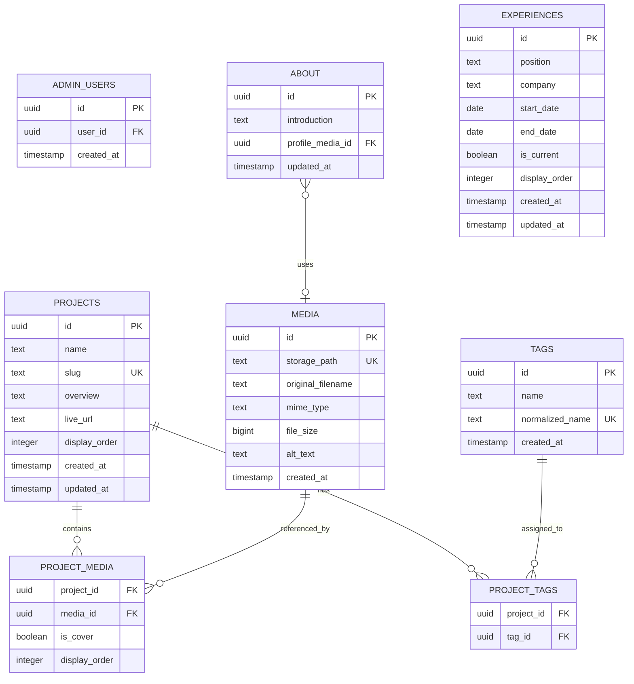

# DATA_MODEL.md

# Database Schema & Relationships

## 1. Overview

The application uses PostgreSQL through Supabase.

The database stores:

- Administrator authorization records.
- About content.
- Experience entries.
- Projects.
- Reusable technology tags.
- Project-to-tag relationships.
- Uploaded image metadata.
- Project-to-image relationships.

There is no draft or publishing system. All saved portfolio content is displayed publicly.

## 2. Entity Relationship Diagram

`auth.users` is managed by Supabase Auth. The application does not create a separate authentication identity table.

## 3. Tables

### 3.1 admin_users

Purpose: Defines which authenticated Supabase users can administer the portfolio.

| Column     | Type        | Constraints                      |
| ---------- | ----------- | -------------------------------- |
| id         | UUID        | Primary key                      |
| user_id    | UUID        | Unique, references auth.users.id |
| created_at | TIMESTAMPTZ | Default now()                    |

Rules:

- A user must have an `admin_users` record to access CMS functionality.
- Authentication alone does not grant admin permissions.
- The initial administrator is provisioned securely.
- Only authorized administrators can manage this allowlist.

### 3.2 about

Purpose: Stores the portfolio owner's introduction and active profile image reference.

| Column           | Type        | Constraints                   |
| ---------------- | ----------- | ----------------------------- |
| id               | UUID        | Primary key                   |
| introduction     | TEXT        | Required                      |
| profile_media_id | UUID        | Nullable, references media.id |
| updated_at       | TIMESTAMPTZ | Default now()                 |

Rules:

- The portfolio has exactly one About record.
- Enforce the singleton requirement through a database constraint or equivalent reliable mechanism.
- Updating About modifies the existing record.
- `profile_media_id` references the one currently active profile image.
- Replacing the profile image updates this reference to the new media record.
- The previous image is not automatically deleted because it may still be referenced elsewhere.

### 3.3 experiences

Purpose: Stores professional experience entries.

| Column        | Type        | Constraints   |
| ------------- | ----------- | ------------- |
| id            | UUID        | Primary key   |
| position      | TEXT        | Required      |
| company       | TEXT        | Required      |
| start_date    | DATE        | Required      |
| end_date      | DATE        | Nullable      |
| is_current    | BOOLEAN     | Default false |
| display_order | INTEGER     | Default 0     |
| created_at    | TIMESTAMPTZ | Default now() |
| updated_at    | TIMESTAMPTZ | Default now() |

Rules:

- Experience entries are ordered most recent first by default.
- `end_date` is null when the experience is current.
- Validate that `end_date` is not earlier than `start_date`.
- `display_order` may support custom ordering if required.
- The application formats dates into the displayed period.

### 3.4 projects

Purpose: Stores portfolio project information.

| Column        | Type        | Constraints      |
| ------------- | ----------- | ---------------- |
| id            | UUID        | Primary key      |
| name          | TEXT        | Required         |
| slug          | TEXT        | Unique, required |
| overview      | TEXT        | Required         |
| live_url      | TEXT        | Nullable         |
| display_order | INTEGER     | Default 0        |
| created_at    | TIMESTAMPTZ | Default now()    |
| updated_at    | TIMESTAMPTZ | Default now()    |

Rules:

- Project name and overview are required.
- Slug must be unique.
- Live URL is optional and must be validated when provided.
- Projects are displayed according to `display_order`.
- Every saved project is immediately visible on the public website.
- No `is_published`, draft, or approval status is required.
- Project details are displayed through the modal, not a separate detail page.

### 3.5 tags

Purpose: Stores reusable technology tags.

| Column          | Type        | Constraints      |
| --------------- | ----------- | ---------------- |
| id              | UUID        | Primary key      |
| name            | TEXT        | Required         |
| normalized_name | TEXT        | Unique, required |
| created_at      | TIMESTAMPTZ | Default now()    |

Examples:

- TypeScript.
- Go.
- React.
- PostgreSQL.
- Next.js.

Rules:

- One tag can be associated with multiple projects.
- Normalize tag names before insertion.
- Normalization trims whitespace and applies consistent casing rules.
- Duplicate normalized names are not allowed.
- Preserve the intended display name in `name`.

### 3.6 project_tags

Purpose: Implements the many-to-many relationship between Projects and Tags.

| Column     | Type | Constraints                                   |
| ---------- | ---- | --------------------------------------------- |
| project_id | UUID | Primary key component, references projects.id |
| tag_id     | UUID | Primary key component, references tags.id     |

Rules:

- Composite primary key: `(project_id, tag_id)`.
- One project can have multiple tags.
- One tag can be reused across multiple projects.
- The same tag cannot be assigned to the same project more than once.
- Deleting a project cascades to its project_tags associations.
- Deleting a tag must safely handle existing associations.

### 3.7 media

Purpose: Stores metadata for uploaded images. The actual image files live in Supabase Storage.

| Column            | Type        | Constraints      |
| ----------------- | ----------- | ---------------- |
| id                | UUID        | Primary key      |
| storage_path      | TEXT        | Unique, required |
| original_filename | TEXT        | Required         |
| mime_type         | TEXT        | Required         |
| file_size         | BIGINT      | Required         |
| alt_text          | TEXT        | Nullable         |
| created_at        | TIMESTAMPTZ | Default now()    |

Rules:

- Supports the About profile image and project images.
- About references one active profile image.
- Projects may reference multiple images.
- Actual image binaries are stored in Supabase Storage.
- Only approved image MIME types are accepted.
- File size must be validated.
- Storage paths must be unique.
- Alt text is supported for accessibility.

### 3.8 project_media

Purpose: Associates multiple images with a project.

| Column        | Type    | Constraints                                   |
| ------------- | ------- | --------------------------------------------- |
| project_id    | UUID    | Primary key component, references projects.id |
| media_id      | UUID    | Primary key component, references media.id    |
| is_cover      | BOOLEAN | Default false                                 |
| display_order | INTEGER | Default 0                                     |

Rules:

- One project can have multiple images.
- The same image cannot be associated with the same project more than once.
- Each project may have one cover image.
- Image ordering is controlled by `display_order`.
- Removing a project association does not automatically delete an image that may be referenced elsewhere.

## 4. Relationships

| Relationship            | Type                 |
| ----------------------- | -------------------- |
| About → Media           | Many-to-one optional |
| Project → Project Tags  | One-to-many          |
| Tag → Project Tags      | One-to-many          |
| Project → Project Media | One-to-many          |
| Media → Project Media   | One-to-many          |

The About table contains one active profile image reference. The Media table can contain many images for different purposes.

## 5. Database Constraints

Required constraints:

- Primary keys for all entities.
- Foreign keys for relational references.
- Unique `admin_users.user_id`.
- Unique `projects.slug`.
- Unique `tags.normalized_name`.
- Composite primary key for `project_tags`.
- Composite primary key for `project_media`.
- Valid experience date ranges.
- Singleton constraint for About.

Deletion behavior:

- Project deletion cascades to project_tags and project_media associations.
- Tag deletion must be restricted or safely detach associations.
- Media deletion must not break active About or project references.
- About image replacement updates the reference before any old image cleanup.
- Storage objects must not be deleted while referenced elsewhere.

## 6. Row Level Security (RLS)

Enable RLS on all application tables.

### Public Access

Unauthenticated visitors may read:

- About.
- Experiences.
- Projects.
- Tags.
- Project Tags.
- Publicly referenced Media metadata.
- Project Media.

Unauthenticated visitors cannot modify content.

All saved content is public. No publishing status is needed to determine visibility.

### Admin Access

Authorized administrators may:

- Read CMS records.
- Create records.
- Update records.
- Delete records.

Authorization must be based on verified Supabase Auth identity and admin allowlist membership.

Storage policies must independently restrict uploads, updates, and deletions to authorized administrators.

## 7. Query & Index Recommendations

Recommended indexes:

- `experiences.display_order`
- `projects.display_order`
- `projects.slug`
- `tags.normalized_name`
- `project_tags.tag_id`
- `project_media.media_id`

Add indexes according to actual query patterns.

## 8. Data Integrity & Image Deletion

- Do not leave orphaned media records.
- Do not delete an image file while it is still referenced by About or a project.
- When replacing the About photo, update `profile_media_id` first.
- When removing a project image, remove its association first.
- When deleting a project, remove its tag and image associations.
- When deleting a tag, handle existing project associations safely.
- Consider a cleanup process for media records and storage files that are no longer referenced.

## 9. Seed Data

Development seed data may include:

- One About record.
- Sample Experience entries.
- Sample Projects.
- Reusable Tags.
- Sample Project Tag associations.

Seed data must not overwrite production content.

## 10. Schema Change Management

- Use Supabase SQL migrations for schema changes.
- Keep migrations in version control.
- Test migrations in development before production deployment.
- Do not manually change production schema without recording the change.
- Keep schema definitions consistent with TypeScript types.

## 11. Final Product Decisions

- About has one active profile photo reference.
- Media is reusable for About and Projects.
- Projects can have multiple images.
- All saved projects appear publicly.
- All successful CMS updates appear publicly without a separate Publish action.
- There is no draft or approval workflow.
- The MVP does not require `is_published` or equivalent visibility status.
